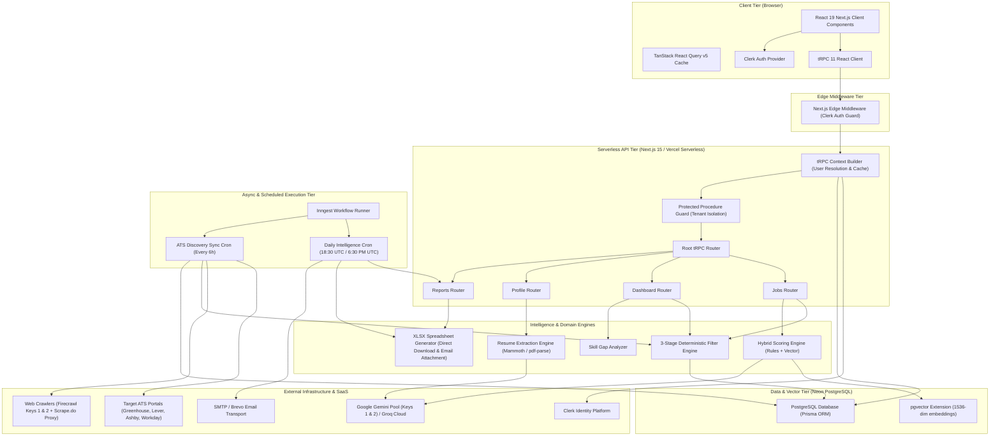
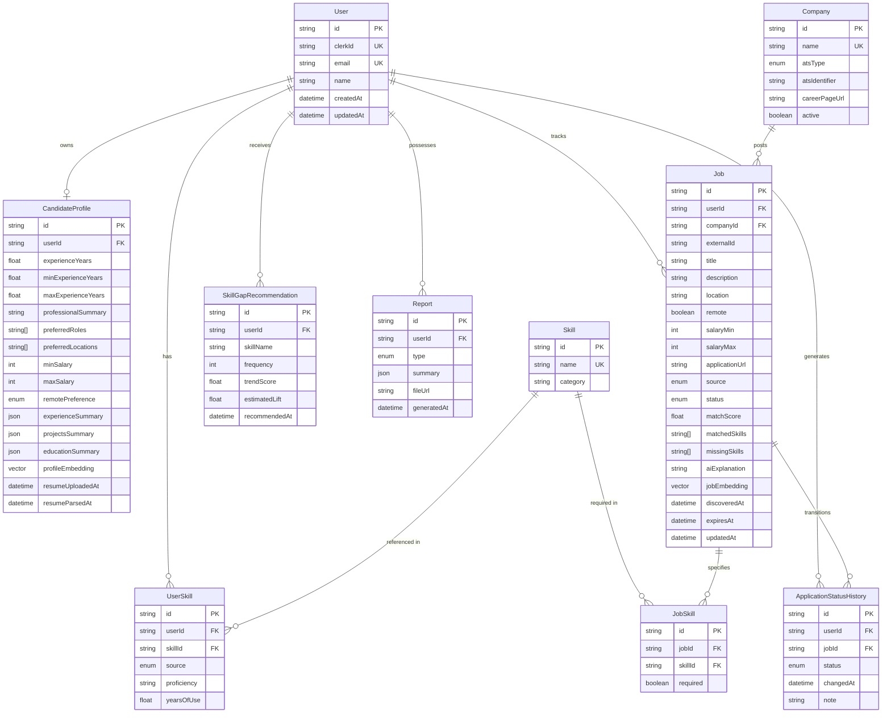
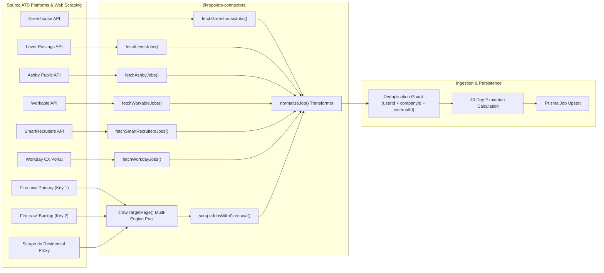
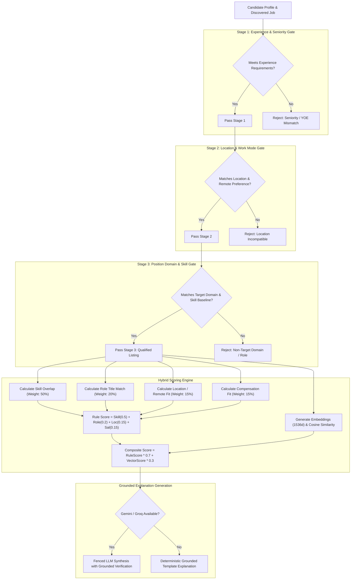
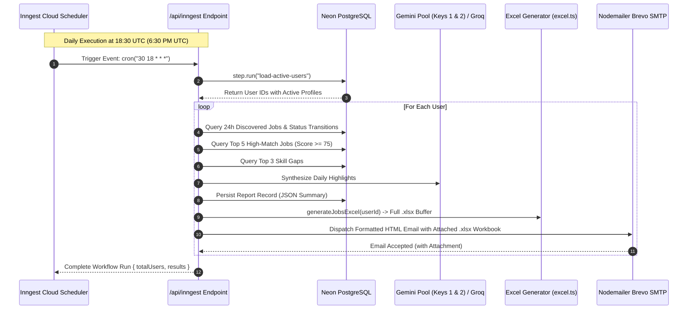

# Architecture & System Design

This document details the architectural topology, data models, domain execution flows, and technical decision records of the AI Job Intelligence Platform.

---

## Table of Contents

- [1. High-Level System Architecture](#1-high-level-system-architecture)
- [2. Domain Model & Entity Relationships](#2-domain-model--entity-relationships)
- [3. ATS Ingestion & Normalization Pipeline](#3-ats-ingestion--normalization-pipeline)
- [4. Multi-Stage Filtering & Scoring Pipeline](#4-multi-stage-filtering--scoring-pipeline)
- [5. Background Job & Inngest Execution Flow](#5-background-job--inngest-execution-flow)
- [6. Architectural Decision Records (ADRs)](#6-architectural-decision-records-adrs)
- [7. Security & Multi-Tenant Isolation](#7-security--multi-tenant-isolation)

---

## 1. High-Level System Architecture

The application is structured into distinct tiers operating across the client, edge middleware, serverless API runtimes, asynchronous job runners, and managed cloud infrastructure.



---

## 2. Domain Model & Entity Relationships

The relational data model is implemented on Neon PostgreSQL via Prisma ORM with vector extensions enabled.



---

## 3. ATS Ingestion & Normalization Pipeline

The ATS connectors module extracts postings from diverse public APIs and web endpoints, translating varying schemas into a standardized `NormalizedJob` interface.



---

## 4. Multi-Stage Filtering & Scoring Pipeline

To avoid costly vector calculations and unnecessary LLM requests on non-viable postings, incoming listings pass through a deterministic three-stage filter before entering the hybrid scoring engine.



---

## 5. Background Job & Inngest Execution Flow

Asynchronous and recurring workflows are managed by Inngest, ensuring reliable retries, step isolation, and failure reporting on serverless infrastructure.



---

## 6. Architectural Decision Records (ADRs)

### ADR-001: Monorepo with Turborepo and pnpm
- **Context**: The platform consists of a full-stack Next.js application, shared TypeScript types, database schemas, AI client utilities, and ATS connectors.
- **Decision**: Use a pnpm workspace orchestrated by Turborepo.
- **Rationale**: Enables strict boundary separation while sharing types and schemas without publishing to a private npm registry. Turborepo provides incremental builds and cached test runs across packages.

### ADR-002: tRPC 11 with SuperJSON over REST / GraphQL
- **Context**: The client frontend and backend API are co-developed in TypeScript.
- **Decision**: Adopt tRPC 11 using SuperJSON transformer.
- **Rationale**: Eliminates code-generation steps required by OpenAPI or GraphQL. Any change to router inputs or return types immediately produces compile-time TypeScript errors on the client. SuperJSON ensures native JavaScript objects (Date, Set, Map) pass seamlessly over HTTP.

### ADR-003: Hybrid Scoring (70% Rules + 30% Semantic Embeddings)
- **Context**: Pure LLM evaluation for hundreds of jobs is cost-prohibitive, slow, and prone to scoring variance. Pure keyword matching fails on synonymy (e.g., "Postgres" vs "PostgreSQL", "Frontend" vs "UI").
- **Decision**: Implement a two-tier scoring system.
- **Rationale**: Rule-based scoring provides predictable, explainable metrics for skills, salary, location, and seniority. Semantic embeddings refine the ranking by measuring conceptual alignment between the candidate summary and job description. Blending at 70/30 maintains determinism while capturing nuance.

### ADR-004: 3-Stage Deterministic Filtration Prior to Scoring
- **Context**: Scoring every raw scraped posting against a candidate profile wastes database I/O, vector calculations, and LLM tokens.
- **Decision**: Gate all scoring behind an explicit 3-stage filter (Experience -> Location -> Role/Skill).
- **Rationale**: Out-of-region, incorrect seniority, or non-technical postings are disqualified in under 1 millisecond using compiled regex and string comparisons.

### ADR-005: Per-User Scoped Jobs with 40-Day TTL
- **Context**: Job listings become stale rapidly, and candidates need personalized application statuses (SAVED, APPLIED, INTERVIEWING).
- **Decision**: Store job records with a composite key of `(userId, companyId, externalId)` and assign an `expiresAt` timestamp set to 40 days past discovery.
- **Rationale**: Prevents cross-user data pollution, enables per-user notes and tracking, and prevents database bloat via scheduled cleanup of expired listings.

### ADR-006: Inngest for Asynchronous Workflow Management
- **Context**: Serverless hosting (Vercel) terminates long-running background processes and lacks a native persistent task queue.
- **Decision**: Use Inngest for event-driven workflows and cron scheduling.
- **Rationale**: Inngest functions execute as step-based HTTP calls, providing automatic retries, concurrency controls, step memoization, and observability without managing a persistent Redis or BullMQ server.

### ADR-007: Neon PostgreSQL with pgvector over Standalone Vector DBs
- **Context**: Matching requires both relational queries (filtering by user, status, salary) and similarity vector search.
- **Decision**: Store embeddings directly in Neon PostgreSQL using the `pgvector` extension.
- **Rationale**: Avoids dual-write synchronizations, distributed transactions, and the operational cost of managing a separate vector database (e.g., Pinecone). Relational and vector filters execute within a single atomic query.

### ADR-008: Grounded, Hallucination-Resistant Match Explanations
- **Context**: Generative models frequently fabricate candidate qualifications or claim matching skills not present in the source data.
- **Decision**: Constrain LLM prompts with strictly validated matched and missing skill arrays, backed by an automatic fallback to deterministic grounded templates.
- **Rationale**: Ensures every claim in the UI is verifiable against the candidate profile and job requirements, preventing candidate deception.

### ADR-009: Multi-Key API Pooling & Tiered Crawler Failover (Gemini, Firecrawl, Scrape.do)
- **Context**: Free and consumption-tiered third-party APIs (Gemini tokens/RPM, Firecrawl scrape credits) frequently hit rate limits (HTTP 429) or quota exhaustion (HTTP 402), which would otherwise abort resume parsing, embeddings, or job discovery.
- **Decision**: Implement resilient `ApiKeyPool` and `CrawlerPool` managers with round-robin load distribution, automatic cooldown quarantining, and multi-tier engine failover.
- **Rationale**:
  - **AI Inference**: Load balances across `GEMINI_API_KEY` and `GEMINI_API_KEY2`. Upon encountering 429 or `RESOURCE_EXHAUSTED`, the exhausted key is quarantined for 5 minutes and execution immediately retries on the backup key. If all Gemini keys fail, tasks fall back to Groq or deterministic heuristics.
  - **Web Crawling**: Dispatches non-ATS scraping requests through Firecrawl Key 1 -> Firecrawl Key 2 -> Scrape.do Residential Proxy (`SCRAPEDO_API_KEY`) -> Direct HTTP fetch. Anti-bot obstacles and depleted credits in one vendor do not compromise discovery sync.

---

## 7. Security & Multi-Tenant Isolation

### 7.1 Multi-Tenant Data Isolation
Every protected procedure in the backend extracts the verified user identity from Clerk authentication tokens via `ctx.userId`. All database queries strictly scope their `where` conditions:

```typescript
// Enforced isolation pattern
const jobs = await ctx.prisma.job.findMany({
  where: {
    userId: ctx.userId, // Non-negotiable tenant boundary
    // ...additional filters
  },
});
```

Unit and hardening tests explicitly verify that attempting to read, update, or transition another user's job or profile throws an authorization error.

### 7.2 Input Validation & Boundary Defense
All incoming request payloads are parsed through Zod schemas before reaching business logic. Unknown or malformed fields are stripped.

### 7.3 Prompt Injection Guardrails
User inputs (resume summaries, job descriptions) injected into LLM evaluation prompts are wrapped in explicit boundary delimiters and instructed not to interpret user-supplied text as system commands.
