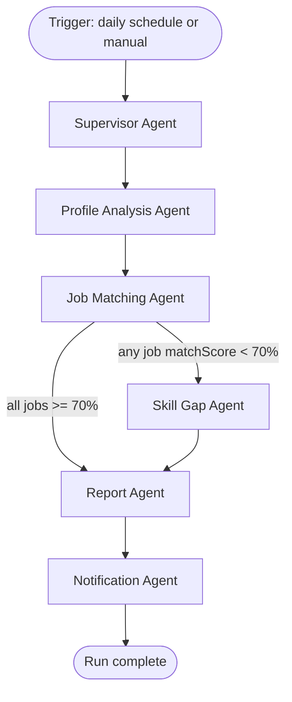

# Agent Design

All agents run inside `apps/agent-worker`, orchestrated as a LangGraph state graph. No agent touches the database, an ATS, an AI provider, or email directly — every side effect goes through an MCP tool call to `apps/mcp-server` (see `mcp/AGENT_TOOL_ACCESS.md` for exactly which tools each agent may call).

## The graph



## Agent responsibilities

### Supervisor Agent
- Entry point for every orchestration run
- Loads run context (which user, what triggered the run — scheduled vs. manual re-run)
- Decides run scope (full discovery + matching vs. matching-only re-run against existing jobs)
- Delegates to Profile Analysis Agent and monitors overall run state; does not call MCP tools directly beyond `getProfile` for routing decisions

### Profile Analysis Agent
- Calls `getProfile` to load the candidate's current structured profile
- On first run after a resume upload/update: interprets and validates newly extracted resume data before it's used for matching (e.g., flags obviously malformed extraction for user review rather than silently matching against bad data)
- Extracts/refines preference signals (role titles, locations, salary) used downstream by Matching
- Output: a normalized profile context object passed to the Matching Agent (in-memory, not persisted separately — see `architecture/MEMORY_ARCHITECTURE.md`)

### Job Matching Agent
- Calls `searchJobs` to get newly discovered/updated jobs for the user
- Calls `scoreJobs` to compute match score, matched skills, and missing skills per job
- Decides routing: if any job in the batch scores below 70%, the graph routes to the Skill Gap Agent before reporting; otherwise it routes straight to the Report Agent
- Does not generate the natural-language AI explanation itself — that's produced by the underlying `scoreJobs` tool (or a dedicated explanation step within it) and just passed through

### Skill Gap Agent
- Runs only when triggered by the Matching Agent's routing condition
- Aggregates missing skills across the current batch of jobs (and optionally recent history) to identify patterns, not just single-job gaps
- Produces/updates `SkillGapRecommendation` records (frequency, estimated lift) via the `updateSkillGaps` tool
- Does not run a live trending-technology web search on every invocation by default — this can be scheduled less frequently (e.g., weekly) to control cost; see `operations/COST_STRATEGY.md`

### Report Agent
- Calls `generateReport` to compile the run's results (new jobs, best matches, skill gaps, status changes) into a structured summary and Excel export
- This is the point in the graph where results become durable (`Report` record written)

### Notification Agent
- Calls `sendEmail` with the report generated by the Report Agent
- Terminal node — on completion or failure, the graph run ends and status is logged

## State passed between nodes

LangGraph state for a run includes (see `architecture/MEMORY_ARCHITECTURE.md` for the full memory model):

```ts
{
  userId: string;
  triggeredBy: "schedule" | "manual";
  profileContext?: NormalizedProfile;
  jobBatch?: Job[];
  scoredJobs?: ScoredJob[];
  skillGapUpdates?: SkillGapRecommendation[];
  report?: ReportSummary;
  notificationStatus?: "sent" | "failed";
}
```

This state is ephemeral per run — it is not itself a persistence layer. Anything that needs to survive beyond the run (profile, jobs, reports, skill gaps) is written to Postgres via MCP tool calls at the appropriate node, not held only in graph state.

## Error handling and partial failure

- If `searchJobs` returns zero new jobs, the graph should still proceed to Report Agent (a "no new jobs today" report is a valid report) rather than short-circuiting.
- If `scoreJobs` fails for a subset of jobs, those jobs should be retried once, then logged and excluded from the batch rather than failing the entire run — see `engineering/ERROR_HANDLING.md`.
- If `sendEmail` fails, the report should still be persisted and visible in-app; email delivery failure should not roll back report generation.

## Related documents

- `mcp/TOOL_REGISTRY.md` — exact tool signatures each agent calls
- `mcp/AGENT_TOOL_ACCESS.md` — which agent may call which tool
- `mcp/MCP_WORKFLOWS.md` — end-to-end call sequences
- `architecture/MEMORY_ARCHITECTURE.md` — what's ephemeral vs. durable
