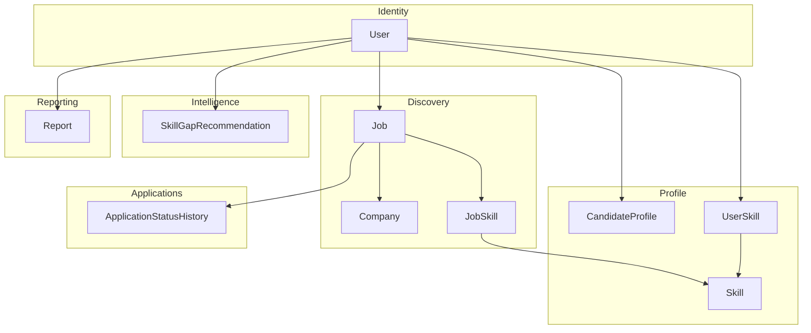

# Domain Model

This document describes the conceptual domain — the entities, their relationships, and the bounded contexts they belong to. For exact field-level schema (types, constraints, indexes), see the source of truth at `packages/db/prisma/schema.prisma`.

## Bounded contexts

### Identity
Owns authentication and account identity. Backed by Clerk; the `User` model is a thin local mirror keyed by `clerkId`.

### Profile
Everything that describes *who the candidate is*: experience, preferred roles, salary expectations, location/remote preferences, and skills — whether extracted from a resume or added manually. This context is the output of resume parsing and the input to matching.

**Key invariant:** the raw resume file is never part of this context's persisted state — only its structured extraction is. See `architecture/MEMORY_ARCHITECTURE.md`.

### Discovery
Everything about *what jobs exist*: the `Company` registry (which companies to poll, and how — via which ATS type), and the `Job` records discovered from them. Jobs are **scoped per-user**, not global — see `architecture/DECISIONS.md` for why.

### Applications
The lifecycle of a user's engagement with a specific job: status transitions from `DISCOVERED` through to a terminal state (`OFFER`, `REJECTED`, `GHOSTED`). This is intentionally separate from `Discovery` because a job's *existence* and a user's *relationship to it* are different concerns — a job can be discovered and expire without ever being acted on.

### Intelligence
Derived insight, not raw data: skill gap recommendations computed by aggregating missing skills across a user's matched jobs. This context reads from Profile and Discovery but doesn't own primary data.

### Reporting
Point-in-time snapshots (`Report`) summarizing everything else — new jobs, best matches, skill gaps, status changes — generated daily/weekly and optionally exported/emailed.

## Cross-context relationships worth calling out

- **`Skill` is shared, not owned by any single context.** It's referenced by both Profile (`UserSkill`) and Discovery (`JobSkill`), which is what makes skill-gap computation (set difference between a job's required skills and a user's skills) straightforward.
- **Matching is computed, not stored as its own entity.** Match score, matched/missing skills, and AI explanation live directly on `Job` rather than in a separate `Match` table, because a match is always 1:1 with a (user, job) pair — there's no independent lifecycle for a "match" apart from its job.
- **Embeddings live alongside their source entity** (`CandidateProfile.profileEmbedding`, `Job.jobEmbedding`) rather than in a separate vector store, since pgvector lets Postgres serve both structured and vector queries without a second system.

## Retention boundary

Only `Job` (and its dependents: `JobSkill`, `ApplicationStatusHistory`) are subject to the 40-day retention policy. `CandidateProfile`, `Skill`, `UserSkill`, `SkillGapRecommendation`, and `Report` are retained indefinitely (until account deletion) since they represent durable knowledge about the user, not perishable listings.
