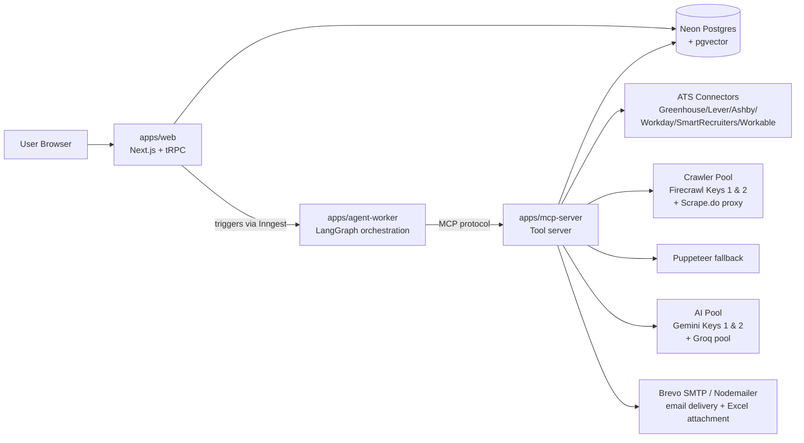
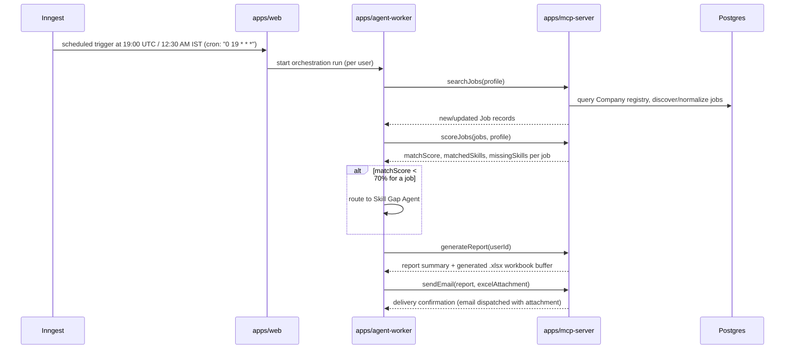

# System Architecture

## The three services



- **`apps/web`** is the only thing the user directly interacts with. It owns the UI (Dashboard, Profile, Jobs) and simple CRUD via tRPC → Prisma.
- **`apps/agent-worker`** runs the LangGraph state machine (Supervisor → Profile → Matching → \[Skill Gap\] → Report → Notification). It has no direct DB or external API access — everything it needs comes from MCP tool calls.
- **`apps/mcp-server`** is the only service allowed to touch ATS connectors, the Firecrawl & Scrape.do crawler pool, Puppeteer, the Gemini & Groq multi-key AI provider pools, and outbound SMTP email delivery. It exposes exactly six tools (see `mcp/TOOL_REGISTRY.md`): `searchJobs`, `scoreJobs`, `getProfile`, `updateSkillGaps`, `generateReport`, `sendEmail`.

This boundary exists so agent logic can be reasoned about, tested, and swapped independently of how job discovery or scoring is actually implemented underneath.

## Daily pipeline (steady state)



## Onboarding flow (one-time per user)

```
User signs up (Clerk)
    ↓
User uploads resume → apps/web temp-stores file
    ↓
apps/web calls MCP tool (or a dedicated parse tool) → Gemini extracts structured data
    ↓
User reviews/edits extracted profile in apps/web UI
    ↓
Resume file deleted; only structured CandidateProfile persists
    ↓
First discovery run kicks off (can be immediate, not just the daily schedule)
```

## Why this shape

- **MCP as the only external-facing surface** means job discovery logic, scoring logic, and email delivery can all change without touching agent orchestration code, and vice versa.
- **`agent-worker` as a separate long-running service** (rather than serverless functions inside `apps/web`) was chosen because LangGraph orchestration runs can be longer than typical serverless timeout windows, and because it keeps agent state/orchestration concerns fully decoupled from the request/response lifecycle of the web app.
- **Kafka was explicitly rejected** in favor of Inngest step functions for triggering and chaining this pipeline — see `architecture/DECISIONS.md` for the reasoning.

## Data flow ownership

| Concern | Owner |
|---|---|
| User auth/session | Clerk, validated in `apps/web` |
| Candidate profile CRUD | `apps/web` (tRPC → Prisma) |
| Job discovery | `apps/mcp-server` (`searchJobs`) |
| Match scoring + embeddings | `apps/mcp-server` (`scoreJobs`) |
| Orchestration/sequencing | `apps/agent-worker` |
| Report generation | `apps/mcp-server` (`generateReport`) |
| Email delivery | `apps/mcp-server` (`sendEmail`) |
| Scheduling | Inngest, triggered from `apps/web` |

## Related documents

- `architecture/AGENT_DESIGN.md` — what each agent node does
- `mcp/MCP_SPEC.md` and `mcp/TOOL_REGISTRY.md` — tool contracts
- `architecture/DOMAIN_MODEL.md` — underlying data model
- `architecture/DECISIONS.md` — key architectural tradeoffs and why
